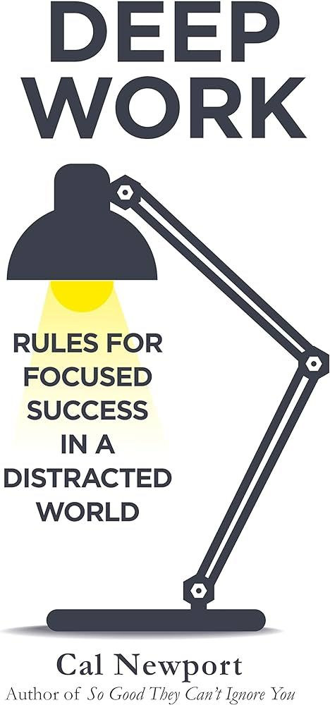
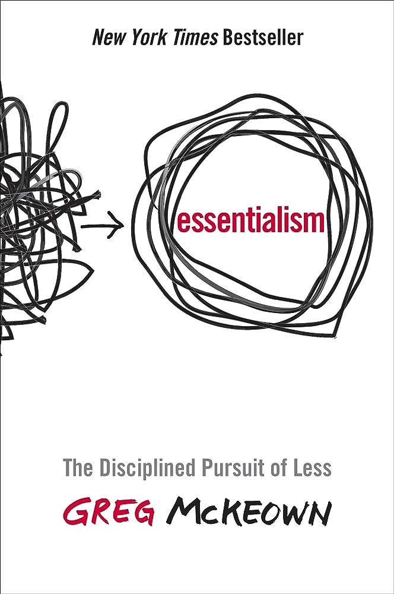

Just finished up Deep Work by Cal Newport, and I'm starting Essentialism by Greg McKeown.  Both of these books are game changers so far.  What books have impacted your life?

{: width="300" style="vertical-align: top; margin: 0 1rem 1rem 0"}
{: width="300" style="vertical-align: top; margin: 0 1rem 1rem 0"}

*Originally posted on LinkedIn: [view the original post](https://www.linkedin.com/feed/update/urn%3Ali%3AugcPost%3A7160429469265002496).*
