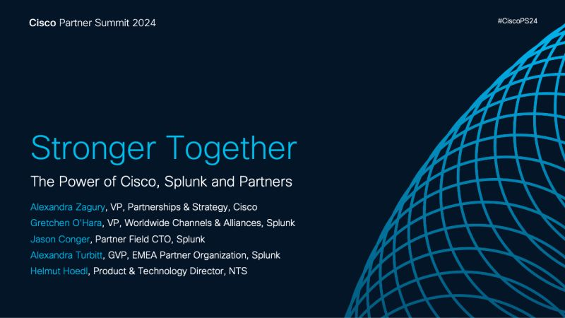

At Cisco Partner Summit, we are showcasing how Cisco and Splunk are stronger together.  Integrations with AppDynamics, ThousandEyes, Cisco XDR, Talos, and so much more - and we're just getting started.  Stay tuned for more to come.

*Originally posted on LinkedIn: [view the original post](https://www.linkedin.com/feed/update/urn%3Ali%3Ashare%3A7257430650364833792).*
