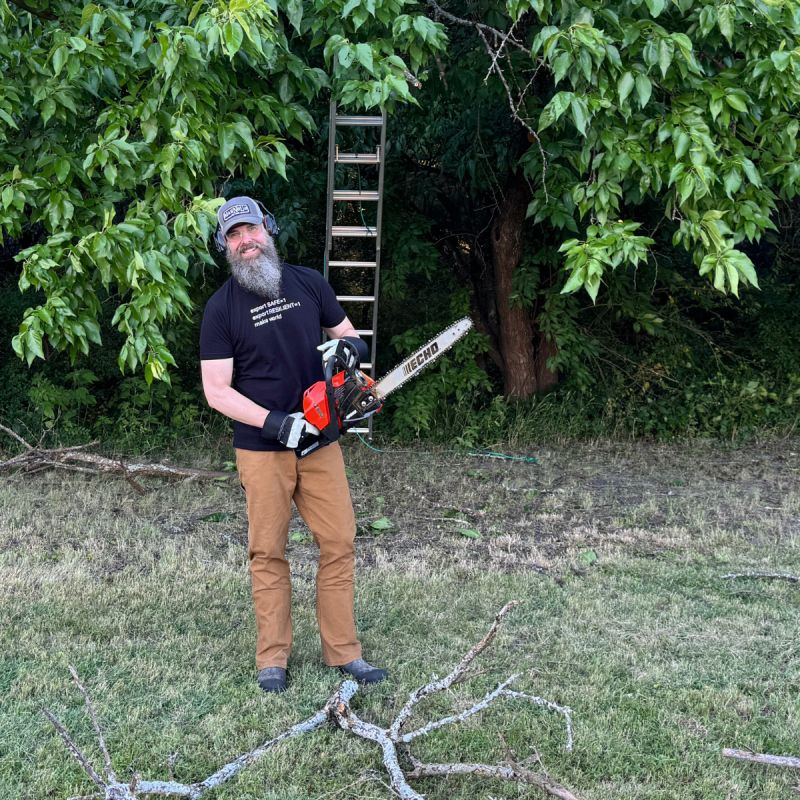

I spent some time recently doing a different type of log management (okay - it was really tree pruning, but stick with me). But, the parallels to data management were too good to ignore. The same principles apply: collect, sort, optimize, route, etc. Different tools, similar thinking.

Here's how tree work stacks up with data management:

- 🧰 Get the right tools - ladder and chainsaw for me this time
- 🌳 Find the right logs - dead branches = outdated data; overgrowth = data clutter
- 🪚 Optimize - some logs got trimmed to fire pit size, others were left longer for curbside pickup
- ↗️ Route intelligently - some logs went to the firepit wood rack for future use, while others went to the curb for city pickup
{: .emoji-list}

Sometimes the best way to understand systems is to step outside of them.

Anyone else find that real-world tasks help sharpen your thinking on tech?

*Originally posted on LinkedIn: [view the original post](https://www.linkedin.com/feed/update/urn%3Ali%3Ashare%3A7343696474922209281).*
