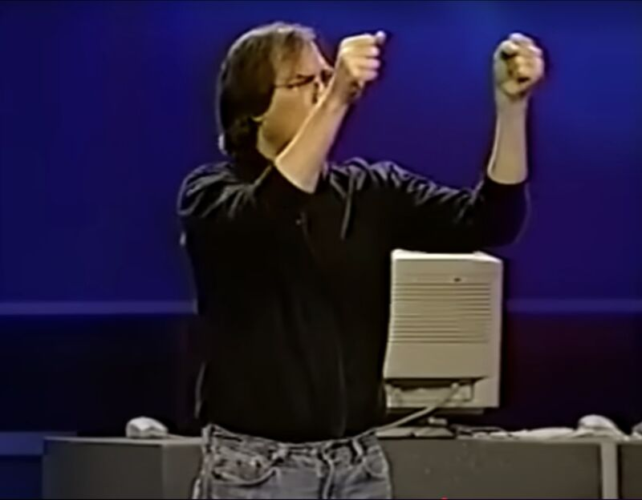
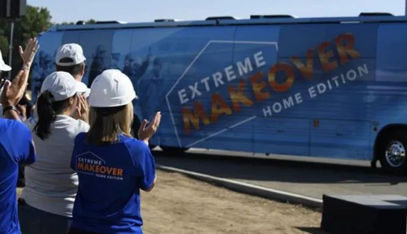

"Do you want this?" -Steve Jobs

"Move that bus!" -Extreme Makeover Home Edition

Too often, technology conversations start with features because features are cool! They showcase innovation, engineering excellence, and creativity. And, I've caught myself getting into the weeds of features on more than one occasion.

➡️ But here's the reality: customers don't buy features, they buy outcomes.

This sentiment hit home the other day when a clip from the 1997 Apple Worldwide Developer Conference popped up in my feed. In it, Steve Jobs is talking about the first LaserWriter printer. He rattles off the impressive tech inside - Canon laser printing engine, Adobe PostScript, AppleTalk - but then he makes a pivot. In his words, "I remember seeing the first printout come out of it and just picking it up and looking at it and thinking, you know, we can sell this because you don’t have to know anything about what’s in that box.  All we have to do is hold this up and go - 𝐃𝐨 𝐲𝐨𝐮 𝐰𝐚𝐧𝐭 𝐭𝐡𝐢𝐬?"

Another example comes from a very different place: Extreme Makeover: Home Edition. At the end of every episode, the crowd yells "𝐌𝐨𝐯𝐞 𝐭𝐡𝐚𝐭 𝐛𝐮𝐬!" The cameras don't zoom in on the granite countertops, the smart appliances, or the new roofline. Instead, they zoom in on the faces of the family, the tears, the joy, and the relief. The features are there, but what matters most is the outcome and how those features change people's lives.

While working with partners, I'm always amazed by the outcomes they create.  Outcomes drive lasting partnership!

*Originally posted on LinkedIn: [view the original post](https://www.linkedin.com/feed/update/urn%3Ali%3AugcPost%3A7363981667797008384).*
