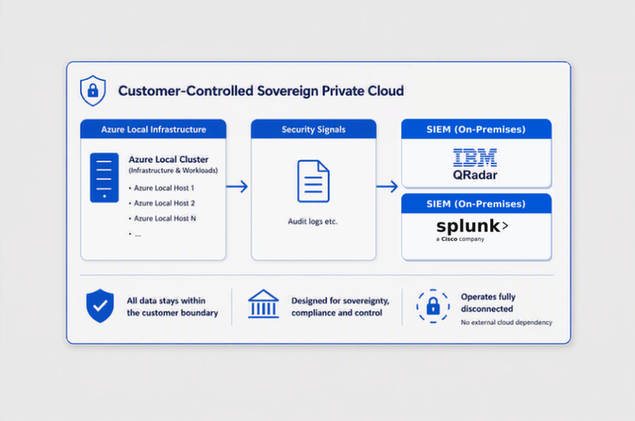

> “Organizations operating in sovereign and disconnected environments need security operations that can adapt to constrained conditions without sacrificing visibility or agility. By working with Microsoft, Splunk is bringing its data platform and analytics capabilities to Azure Local, enabling security teams to gain operational insight, accelerate investigations, and respond more effectively within highly controlled environments. Together, we’re enabling a more flexible and resilient approach to security operations for organizations where connectivity, sovereignty, and operational continuity are equally critical.”
>
> — Jason Conger, Field CTO, Splunk, a Cisco company

Read more on the Microsoft Tech Community blog: [Expanding the Azure Local Security Ecosystem with IBM QRadar and Splunk](https://techcommunity.microsoft.com/blog/azurearcblog/expanding-the-azure-local-security-ecosystem-with-ibm-qradar-and-splunk/4535101)

*Originally posted on LinkedIn: [view the original post](https://www.linkedin.com/feed/update/urn%3Ali%3Ashare%3A7491572212810801152).*
